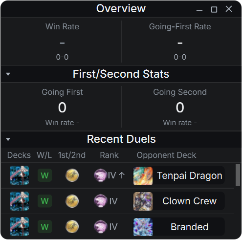
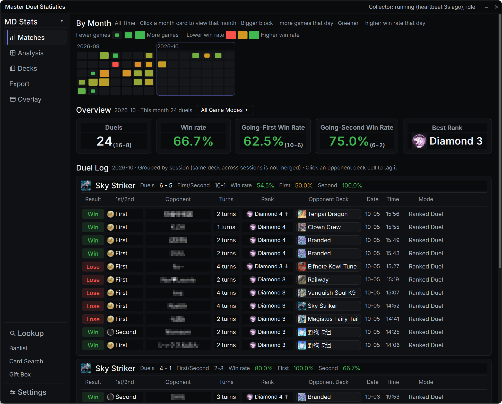
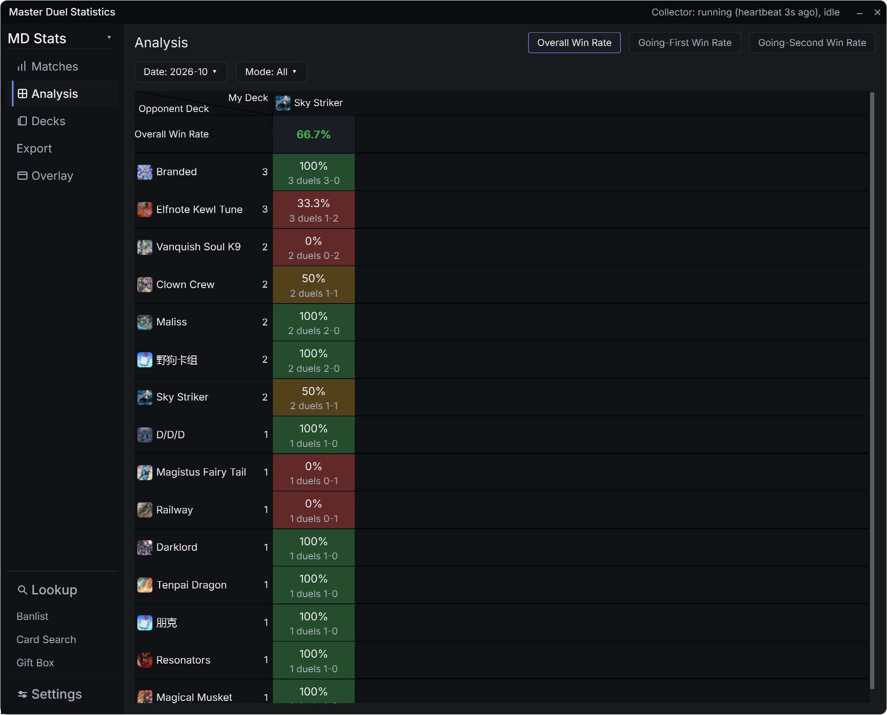

# Master Duel Stats（マスターデュエル戦績ツール）

[English](README.md) | [简体中文](README.zh-CN.md) | **日本語**

『遊戯王マスターデュエル』専用の**完全ローカル**戦績トラッカーです。
常駐コレクターがデュエルごとに自動でローカルの SQLite データベースに記録し、
最前面のフローティングウィンドウとダッシュボードで、勝率・相手デッキ・
ランク変動・環境分析をひと目で確認できます。UI は**日本語 / 中文 / English**
に対応（ダッシュボードの設定でリアルタイム切り替え）。

| フローティング | ダッシュボード · 対戦 |
|---|---|
|  |  |

| ダッシュボード · 分析マトリクス |
|---|
|  |

> 本ツールは非公式のファンメイドであり、KONAMI および Untapped とは無関係です。
> すべての戦績データはお使いの PC 内にのみ保存され、**収集・アップロードは一切行いません**。

## 機能

- **フローティングウィンドウ**：常に最前面の小ウィンドウで、セッション概要 /
  先攻後攻統計 / 最新対戦をリアルタイム表示。相手デッキのセルをクリックして
  タグ付け。三言語 UI は設定からその場で切り替え可能。
- **ダッシュボード**：月間ヒートマップ、サマリー、対戦ログ、自デッキ × 相手
  デッキの勝率マトリクス、ティア表、制限レギュレーション、デッキ構築参照、
  プレゼントボックス、月別 / モード別の CSV・JSON エクスポート。
- **自動収集**：常駐コレクターがプレイ中のデュエルを自動でデコード・記録。
  操作は一切不要。
- **相手デッキのタグ付け & 推定**：手動タグ付けに加え、カードテーブル類似度に
  よる自動推定候補を内蔵。
- **ランク & RATE ポイント**：対局後、ゲームメモリから**読み取り専用**で
  実際のランクと RATE を取得。
- **三言語のカード / デッキ名**：約 14,000 枚のカード名を内蔵
  （英語 / 中国語 / 日本語）。
- **デッキ画像の管理**：デッキ名管理から任意のデッキに画像を設定できます ——
  カード名を検索してカード絵を選ぶ、またはサイトの Tier リストから取得。
  自作デッキ（Tier リストに無いもの）にも画像と検索が効きます。
- **参照データの更新を UI から**：ダッシュボード「設定 → データツール →
  参照ライブラリ更新」で OK。コマンドは不要です。
- **モードの複数選択フィルター**：対戦ページと分析ページの両方で、モード
  （ランク / レーティング / DC カップ / イベント）を Excel のように
  チェックで選べます。2 ページは独立しており、チェックすると即座に反映されます。
- **手札誘発の検出**：その対戦の最初の 2 ターンで双方が使った 12 種の手札誘発
  （イラスト違いも含む）を自動判定 —— 対戦ページ右端にカード画像の 2 列
  （1 マス最大 5 枚、超過分は `+N`）、「分析 → 手札誘発」では
  自デッキごとに**先攻 / 後攻**の内訳と勝率を表示します。

## インストールと起動

### ダウンロード（[Releases](../../releases/latest)）

| アセット | サイズ | 必要なもの |
|---|---|---|
| `masterduel-stats-Setup-1.1.0.exe` | 約29 MB | **ワンクリックインストール（推奨）** —— インストールしてすぐ使えます。対戦データは既定でプログラムと同じ場所、`Program Files` に入れた場合は `%LOCALAPPDATA%\MasterDuelStats` に保存されます |
| `masterduel-stats-v1.1.0-win64-full.zip` | 約39 MB | **不要** —— Python と全依存を同梱。解凍して `MDStats.exe` を実行するだけ |
| `masterduel-stats-v1.1.0-patch-win64.zip` | **約0.7 MB** | **既存ユーザーの更新用**（ポータブル版）—— プログラム本体のみ。元のフォルダーに上書き解凍するだけ。対戦データには触れません |
| `masterduel-stats-v1.1.0-win64-lite.zip` | 約6 MB | Python 3.13 のインストールが必要。初回の `MDStats.exe` が依存関係を自動インストール |
| Source code (zip / tar.gz) | 自動 | 開発者向け。各 tag に GitHub が自動添付 |

**ポータブル版の更新**：`patch.zip`（1 MB 未満）をダウンロードし、
**アプリとコレクターを完全に終了**してから（トレイアイコン → 終了）、
アーカイブ内の `master-duel-stats` を既存フォルダーに上書き解凍してください。
対戦データは `data/` にあり、パッチでは触れません。インストーラー版は新しい
`Setup` を実行し直すのが一番簡単です。

**対戦データの保存場所**：インストーラー版は既定で**プログラムと同じフォルダー**（`<インストール先>\data`）に保存します —— フォルダーごと別の PC に移せます。`Program Files` のような書き込み不可の場所では `%LOCALAPPDATA%\MasterDuelStats` に自動で切り替わります。どちらも **ダッシュボード → 設定 → 画面 → 対戦データ** から任意のフォルダーに変更できます（UI の再起動で有効）。

**一番手軽な方法**：[Python 3.13](https://www.python.org/downloads/) を
インストールし（*Add to PATH* にチェック、または `py` ランチャーを有効化して
おく）、ダウンロードを解凍して **`MDStats.exe` をダブルクリック**してください。
Python を自動で探し、初回は依存関係を自動インストールし（進捗は画面に出ます）、
常駐コレクターとフローティングウィンドウを起動します。失敗時はコンソールが
閉じてしまうのではなく、**ダイアログで理由を表示**し `data/launcher.log` に
記録します。

**個別に手動起動する場合**（解凍先フォルダで）：

```
python tools\duel_collector.py     # 常駐コレクター
python tools\duel_ui.py            # フローティング + ダッシュボード
```

スクリプトでよく使う場合は `start.bat` が同じ処理を行います。

**停止するには**：フローティングウィンドウの ×（閉じる）を押します — それが
ツール全体を終了します。ダッシュボードはフローティングウィンドウ、またはトレイ
アイコンから開けます。Python が複数ある場合は、正しい `python.exe` のフルパスを
`MDStats.exe` と同じフォルダの `python_path.txt` に記入すると、そちらを優先します。

### 初回起動

* データベースは**初回起動時に自動作成**（`data/masterduel.db`）。
  データはすべて `data/` 内に保存されます；
* **デッキ推定 / 構築参照ライブラリ**は、初回に一度オンラインで取得：
  ```
  python tools\fetch_mdm_decks.py --all
  ```
  （同じ操作はダッシュボード「設定 → データツール → 参照ライブラリ更新」からも可能）
  （約 2〜3 分。毎月の更新を推奨）；
* **制限レギュレーション / デッキ名 / デッキ画像**：ダッシュボードの設定
  ページからワンクリックで取得（毎月更新）；
* （任意）Untapped 公開 API で過去のデュエルを補完するには、
  `data/untapped_ids.json` にアカウント ID を記入
  （形式は `tools/fetch_untapped_api.py` 冒頭を参照）。

## データとプライバシー

* 戦績データ = **ゲームログ解析 + 読み取り専用メモリ取得**の 2 系統
  （詳細は DESIGN.md）；
* メモリ取得は**読み取り専用**：書き込み・注入・ゲームファイルの改変は一切
  ありません —— `core/memread/redline.py` が禁止リストを定義し、
  `tests/test_memread_guard.py` の 25 個の単体テストが強制しています；
* 公式カード DB や公開ランキング取得など、明示的にクリックした操作以外で
  ネットワークに接続しません。対戦データベース・記録・個人状態は
  すべて `data/` 内に留まります。

## 免責事項

* 非公式のファンツールであり、KONAMI とは無関係です。ゲーム内アセット
  （カードイラスト、アイコン）の著作権は KONAMI および各権利者に帰属します；
* サードパーティ素材・フォントのライセンスは [NOTICE](NOTICE) を参照；
* ランク / RATE のメモリ読み取りは個人レビュー専用 —— **自己責任でご利用ください**；
* コードは [GPL-3.0](LICENSE) でライセンスされています。サードパーティ素材は
  対象外（NOTICE を参照）。

## 動作環境

* Windows 10/11（メモリ取得は Windows API を使用）
* Python 3.13
* 依存関係は [requirements.txt](requirements.txt) を参照
  （PySide6-Essentials、pypinyin）
