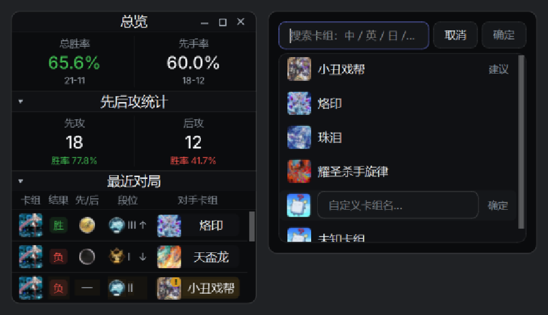

# Master Duel Stats

[中文](#简介) | English below

**Master Duel Stats**（《游戏王 Master Duel》战绩统计）是一个**纯本地**的桌面工具：
一边打游戏，一边自动把每局对战归档进本地数据库，并用一个置顶悬浮窗和一块看板
把胜负、对手卡组、段位起伏、 Tier 环境等数据直观地摆在你面前。

> 本工具为非官方粉丝作品，与 KONAMI、Untapped 均无关联。
> 所有战绩数据只保存在你自己的电脑上，**不收集、不上传任何数据**。

## 截图

| 悬浮窗 | 看板 · 战绩页 |
|---|---|
|  |  |

| 看板 · 对手卡组标注 |
|---|
|  |

（截图为内置 demo 假数据渲染，非真实战绩。）

## 功能

- **悬浮窗**：置顶小窗实时显示总览 / 先后攻统计 / 最近对局；点对手卡组格
  直接标注；内置三语切换（中 / 英 / 日，实时生效）。
- **看板**：月历热力图、战绩总览、逐局记录、我方 × 对手胜率矩阵、
  Tier 表、禁限表、卡组构成参照、礼盒查询、按月按模式导出 CSV / JSON。
- **自动采集**：常驻采集器在对局结束时自动解码记录并入库，零操作。
- **对手卡组标注与反推**：手动标注之外，内置基于卡表相似度的反推建议。
- **段位与巅峰积分**：对局结束后从游戏内存**只读**读取真实段位与 RATE 积分。
- **三语卡名 / 卡组名**：内置 1.4 万张卡的中 / 英 / 日卡名表。

## 安装与运行

1. 安装 [Python 3.13](https://www.python.org/downloads/)（勾选 *Add to PATH*，
   或确保 `py` 启动器可用）；
2. 克隆本仓库，在仓库根目录执行：
   ```
   pip install -r requirements.txt
   ```
3. 双击 `启动.bat` —— 它会依次拉起常驻采集器（无窗口）和悬浮窗，
   看板会自动打开。也可以分别手动运行：
   ```
   python tools\duel_collector.py     # 常驻采集器
   python tools\duel_ui.py            # 悬浮窗 + 看板
   ```

### 首次运行

* 数据库无需手动建表：**首次启动自动创建 schema**，之后所有数据都在本地
  `data/masterduel.db`（SQLite）。
* **对手卡组反推 / 参照库**需要联网抓一次参照数据：
  ```
  python tools\fetch_mdm_decks.py --all
  ```
  （来自 masterduelmeta.com 的公开数据，约 2~3 分钟，建议每月刷新一次。）
* **禁限表 / 卡组名称 / 卡组图**：看板「设置」页提供了一键工具，按月刷新即可。
* （可选）想用 Untapped 公开 API 补录历史对局：在 `data/untapped_ids.json`
  填入你自己的账号标识（格式见 `tools/fetch_untapped_api.py` 顶部说明）。

## 数据与隐私

* 战绩数据来源 = **游戏日志解析 + 只读内存采集**，两条腿互补（详见 DESIGN.md）；
* 内存采集**只读**：不写入、不注入、不修改任何游戏文件 ——
  `core/memread/redline.py` 定义了禁区清单，`tests/test_memread_guard.py`
  用 25 项单测强制执行；
* 除「官网查卡」「抓取公开榜单」等少数显式点击的联网操作外，工具不联网；
  战绩库、对局记录、个人状态全部留在本机。

## 声明

* 本工具与 KONAMI 无关，游戏内素材（卡绘、图标）版权归 KONAMI 及各自权利方；
* 第三方素材与字体的许可说明见 [NOTICE](NOTICE)；
* 段位 / 积分等内存读取仅供个人复盘使用，**使用风险自负**；
* 本项目使用 [GPL-3.0](LICENSE) 授权，第三方素材不适用该授权（见 NOTICE）。

## 环境要求

* Windows 10/11（内存采集依赖 Windows API）
* Python 3.13
* 依赖见 [requirements.txt](requirements.txt)（PySide6-Essentials、pypinyin）

---

**Master Duel Stats** is a local-only desktop tracker for *Yu-Gi-Oh! Master Duel*:
a resident collector archives every duel into a local SQLite database, and a
topmost floating window plus a dashboard visualize win rates, opponent decks,
rank progress and the metagame — with UI in Chinese / English / Japanese.
Read-only memory access, no injection, no data leaves your machine.
Licensed under GPL-3.0 (code); see [NOTICE](NOTICE) for third-party assets.
